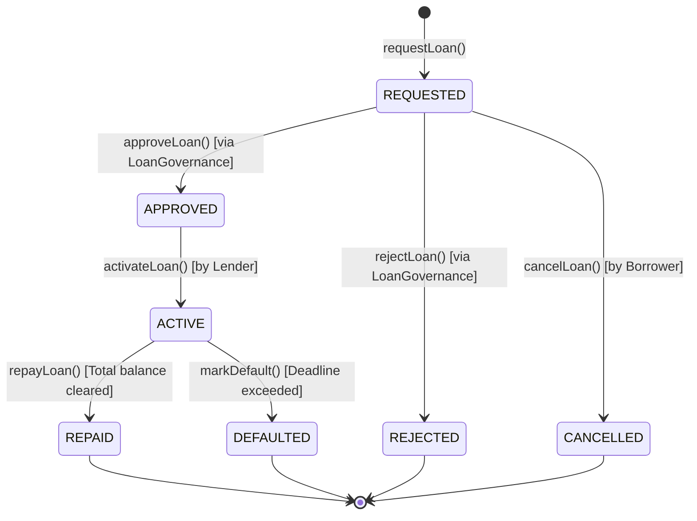

# CredChain — AI-Powered Decentralized Credit Scoring & Micro-Lending

<div align="center">

[](https://soliditylang.org/)
[](https://getfoundry.sh/)
[](https://openzeppelin.com/)
[](https://chain.link/)
[](https://nextjs.org/)
[](https://fastapi.tiangolo.com/)
[](https://scikit-learn.org/)
[](https://github.com/RachanaB5/CredChain)

**Trust. Verify. Borrow. Repay.**

*An academic FinTech decentralized application combining off-chain explainable machine learning with Ethereum smart contracts, non-custodial token escrow, multi-signature governance, Chainlink price oracles, and deterministic on-chain borrower reputation.*

[Live DApp](http://localhost:3000) • [API Swagger Docs](http://localhost:8000/docs) • [Smart Contracts Spec](docs/smart-contracts.md) • [Architecture Guide](docs/architecture.md)

</div>

---

## 📌 Table of Contents

- [Overview & Problem Statement](#-overview--problem-statement)
- [System Architecture](#-system-architecture)
- [Four Blockchain Modules](#-four-blockchain-modules)
- [Machine Learning Credit Scoring Engine](#-machine-learning-credit-scoring-engine)
- [Frontend DApp Pages](#-frontend-dapp-pages)
- [Testing & Security Validation](#-testing--security-validation)
- [Quick Start Guide](#-quick-start-guide)
- [Four-Member Team Division & Ownership](#-four-member-team-division--ownership)
- [License & Disclaimer](#-license--disclaimer)

---

## 💡 Overview & Problem Statement

### The Problem
1. **The Credit-Invisible Exclusion**: Billions of gig workers, micro-entrepreneurs, and unbanked individuals are rejected by traditional banks due to the lack of centralized credit histories (FICO, CIBIL, Experian).
2. **DeFi Over-Collateralization**: Existing protocols like Aave and Compound require **150%–200% collateral**, excluding the very borrowers who seek loans due to capital scarcity.
3. **The Black-Box AI Vulnerability**: Permitting an autonomous AI model to disburse on-chain funds directly creates catastrophic exploit risks from model poisoning, adversarial inputs, or API hallucinations.

### The CredChain Solution
CredChain establishes a secure, hybrid FinTech architecture:
- **Consented Off-Chain AI Underwriting**: A Scikit-Learn `GradientBoosting` classifier predicts default probability with calibrated confidence and outputs top SHAP feature importances.
- **Cryptographic Parameter Anchoring**: The assessment parameters are hashed (`keccak256`) and registered on-chain for tamper-proof auditability.
- **Decentralized Multi-Sig Governance**: Smart contracts require human or multi-party consensus (`APPROVER_ROLE`) before escrow releases funds. High-value loans ($\ge 5,000$ tokens) strictly demand 2 independent approvals.
- **Deterministic On-Chain Reputation**: Verified loan repayments dynamically increase borrower reputation towards 100, while defaults penalize it to 0.

---

## 🏛 System Architecture

```
┌────────────────────────────────────────────────────────────────────────┐
│                          OFF-CHAIN SUBSYSTEM                            │
│                                                                        │
│   Borrower Features ──► FastAPI Backend (Python 3.12)                   │
│                                │                                       │
│                                ▼                                       │
│                     GradientBoosting Classifier                        │
│                   Calibrated Default Risk Scoring                      │
│                                │                                       │
│                                ▼                                       │
│                 Risk Category + SHAP Feature Factors                   │
│                 + Keccak256 Integrity Hash Reference                   │
└────────────────────────────────┬───────────────────────────────────────┘
                                 │
             Wallet Signs Loan Terms & ML Assessment Hash
                                 │
┌────────────────────────────────▼───────────────────────────────────────┐
│                          ON-CHAIN SUBSYSTEM                            │
│                         (Ethereum Sepolia / Local Anvil)               │
│                                                                        │
│   ┌───────────────────┐               ┌──────────────────────────┐    │
│   │  LoanManager.sol  │◄─────────────►│     LoanEscrow.sol       │    │
│   │ (State Machine)   │               │ (Non-Custodial Custody)  │    │
│   └─────────┬─────────┘               └─────────────┬────────────┘    │
│             │                                       │                 │
│             ▼                                       ▼                 │
│   ┌───────────────────┐               ┌──────────────────────────┐    │
│   │LoanGovernance.sol │               │      CredToken.sol       │    │
│   │(Multi-Sig Auth)   │               │   (ERC-20 Test Asset)    │    │
│   └─────────┬─────────┘               └──────────────────────────┘    │
│             │                                                         │
│             ▼                                                         │
│   ┌───────────────────┐               ┌──────────────────────────┐    │
│   │ CollateralOracle  │◄─────────────►│    BorrowerReputation    │    │
│   │(Chainlink ETH/USD)│               │ (Deterministic Scoring)  │    │
│   └───────────────────┘               └──────────────────────────┘    │
└────────────────────────────────────────────────────────────────────────┘
```

---

## ⛓ Four Blockchain Modules

Each module represents a distinct smart contract domain implemented with OpenZeppelin v5 and Solidity `0.8.24`:



### Module 1: Loan Lifecycle Management (`LoanManager.sol`)
- **Core Concept**: Smart contract state machines and event-driven architecture.
- **7 States**: `REQUESTED`, `APPROVED`, `ACTIVE`, `REPAID`, `DEFAULTED`, `REJECTED`, `CANCELLED`.
- **Enforcement**: Prevents unauthorized transitions, over-repayment, and double applications.

### Module 2: ERC-20 Tokenization & Escrow (`CredToken.sol` + `LoanEscrow.sol`)
- **Core Concept**: Token standards, non-custodial collateral custody, checks-effects-interactions.
- **`CredToken.sol`**: ERC-20 token (`CRED`) with a 100M cap, per-tx mint limits, and public testnet faucet.
- **`LoanEscrow.sol`**: Manages isolated collateral, lender disbursements, and default seizures with `ReentrancyGuard`.

### Module 3: Decentralized Authorization & Governance (`LoanGovernance.sol`)
- **Core Concept**: Role-Based Access Control (RBAC) and multi-signature authorization.
- **Workflow**: Standard loans require 1 approver signature; high-value loans ($\ge 5,000$ CRED) strictly require **2 independent approvers**.
- **Security**: Replay-resistant vote tracking and circuit-breaker pause controls.

### Module 4: Chainlink Oracle & Borrower Reputation (`CollateralOracle.sol` + `BorrowerReputation.sol`)
- **Core Concept**: Decentralized oracles and persistent on-chain reputation.
- **`CollateralOracle.sol`**: Integrates Chainlink ETH/USD aggregator with 3,600s staleness checks and non-positive price guards.
- **`BorrowerReputation.sol`**: Deterministic score calculation updated only by authorized smart contracts:
  $$\text{Reputation Score} = \frac{\text{Repaid Loans} \times 100}{\text{Total Loans}}$$
  *(First-time borrowers start with a neutral baseline of 50)*.

---

## 🧠 Machine Learning Credit Scoring Engine

- **Model**: `GradientBoostingClassifier` trained on 2,000 synthetic micro-lending profiles with realistic distributions.
- **Metrics**: **74.75% Accuracy**, **0.7268 ROC-AUC**, Precision: 0.519, Recall: 0.394.
- **Top Predictive Features**:
  1. `monthly_debt` (20.8%)
  2. `employment_length_years` (18.8%)
  3. `debt_to_income_ratio` (17.7%)
  4. `credit_history_length_years` (13.0%)
  5. `loan_amount` (12.2%)
- **Explainability**: Returns risk categories (`LOW`, `MEDIUM`, `HIGH`), calibrated confidence, and human-readable factor impact directions.

---

## 💻 Frontend DApp Pages

Built with **Next.js 14 App Router**, **TypeScript**, **Tailwind CSS**, and **Wagmi/Viem**:

| Page | Route | Description |
|---|---|---|
| **Landing** | `/` | Platform introduction, architecture summary, and 1-click test token faucet. |
| **Dashboard** | `/dashboard` | Real-time wallet telemetry, CRED balance, active loans, reputation, and Chainlink ETH/USD feed. |
| **Credit Assessment** | `/credit-assessment` | Consented financial application form with live FastAPI risk evaluation and SHAP factors. |
| **Apply for Loan** | `/apply-loan` | Form to deposit collateral into `LoanEscrow` and submit a loan request on-chain. |
| **Marketplace** | `/marketplace` | Peer-to-peer liquidity provider dashboard for lenders to inspect and fund approved loans. |
| **Repayments** | `/repayment` | 2-step portal to approve CRED and repay loans, automatically unlocking collateral. |
| **Reputation** | `/reputation` | Transparent on-chain borrower score, completion rates, and historical activity breakdown. |
| **Governance** | `/governance` | Multi-sig review portal for addresses holding `APPROVER_ROLE` to approve or reject loans. |
| **Explorer** | `/explorer` | Verified contract addresses on Sepolia / Anvil with 1-click copy and block explorer links. |
| **Admin Console** | `/admin` | Protocol circuit breakers (`pause` / `unpause`) and Chainlink oracle health monitor. |

---

## 🧪 Testing & Security Validation

```bash
Ran 7 test suites in 121.98ms: 111 tests passed, 0 failed, 0 skipped
======================================================================
  - LoanManagerTest:        43 passed (Unit, Fuzz, Invariants)
  - CredTokenTest:          36 passed (Cap checks, Faucet, Pauses)
  - LoanEscrowTest:         10 passed (Custody, Atomic release, Seizures)
  - LoanGovernanceTest:      5 passed (Multi-sig thresholds, Rejections)
  - CollateralOracleTest:    8 passed (Price validity, Staleness checks)
  - BorrowerReputationTest:  7 passed (Score math, Default penalties)
  - IntegrationTest:         2 passed (Full happy path & default workflow)

Backend Pytest Suite: 7 passed in 1.89s
======================================================================
  - Health check, Valid assessment, Consent enforcement, Input bounds,
    Credit history, Analytics overview, Borrower profile.
```

---

## 🚀 Quick Start Guide

### Prerequisites
- Node.js 18+ & npm
- Python 3.11+
- [Foundry](https://getfoundry.sh/) (`curl -L https://foundry.paradigm.xyz | bash && foundryup`)
- MetaMask browser extension

### 1. Start Local Blockchain & Deploy Contracts
```bash
# Terminal 1: Start Anvil local blockchain
anvil --port 8545 --chain-id 31337

# Terminal 2: Deploy smart contracts
cd blockchain
forge script script/Deploy.s.sol --tc Deploy --rpc-url http://127.0.0.1:8545 --broadcast
```

### 2. Start Backend API & Train ML Model
```bash
cd backend
python3 -m venv .venv && source .venv/bin/activate
pip install -r requirements.txt
python3 -m app.ml.train
uvicorn app.main:app --host 0.0.0.0 --port 8000 --reload
```

### 3. Start Frontend DApp
```bash
cd frontend
npm install
npm run dev
```
Open **[http://localhost:3000](http://localhost:3000)** in your browser!

### 4. Configure MetaMask for Localhost
- **Network Name**: `Anvil Localhost`
- **RPC URL**: `http://127.0.0.1:8545`
- **Chain ID**: `31337`
- **Currency Symbol**: `ETH`
- *To get 1,000 free test ETH: Connect wallet and click the green **"Get 1,000 Test ETH"** button in the header.*

---

## 👥 Four-Member Team Division & Ownership

To maximize clarity, ownership, and grade evaluation, the project is structured into four distinct, non-overlapping domains:

```
┌──────────────────┐    ┌──────────────────┐    ┌──────────────────┐    ┌──────────────────┐
│     MEMBER 1     │    │     MEMBER 2     │    │     MEMBER 3     │    │     MEMBER 4     │
│   Loan Lifecycle │    │   Tokenization   │    │  Governance &    │    │ Oracles, AI &    │
│   State Machines │    │    & Escrow      │    │  Authorization   │    │ On-Chain Rep.    │
└──────────────────┘    └──────────────────┘    └──────────────────┘    └──────────────────┘
```

| Member | Domain & Ownership | Key Files | Core Concepts Demonstrated |
|---|---|---|---|
| **Member 1** | **Smart Contract State Machines & Loan Lifecycle** | `LoanManager.sol`, `ILoanManager.sol`, `LoanManager.t.sol` | Finite state machines, event-driven smart contracts, basis-points interest calculation, loan transition guards. |
| **Member 2** | **ERC-20 Tokenization, Collateral & Escrow** | `CredToken.sol`, `LoanEscrow.sol`, `CredToken.t.sol`, `LoanEscrow.t.sol` | OpenZeppelin ERC-20 standard, non-custodial vaults, checks-effects-interactions pattern, `ReentrancyGuard`, default seizures. |
| **Member 3** | **Decentralized Authorization & Governance** | `LoanGovernance.sol`, `ILoanGovernance.sol`, `LoanGovernance.t.sol` | Role-Based Access Control (RBAC), multi-party consensus, dynamic thresholds ($< 5\text{K}$ vs $\ge 5\text{K}$), circuit breakers. |
| **Member 4** | **Chainlink Oracles, Reputation & AI Pipeline** | `CollateralOracle.sol`, `BorrowerReputation.sol`, `backend/app/ml/`, `backend/app/api/` | Chainlink Aggregator V3, staleness checks, deterministic reputation math, GradientBoosting ML default modeling. |

---

## 📄 License & Disclaimer

This project is licensed under the **MIT License** — see the [LICENSE](LICENSE) file for details.

> ⚠️ **ACADEMIC DISCLAIMER**: This application is an educational prototype built exclusively for testnet environments. It does not use real financial assets, does not provide legal financial advice, and should never be used for real-money lending operations.
