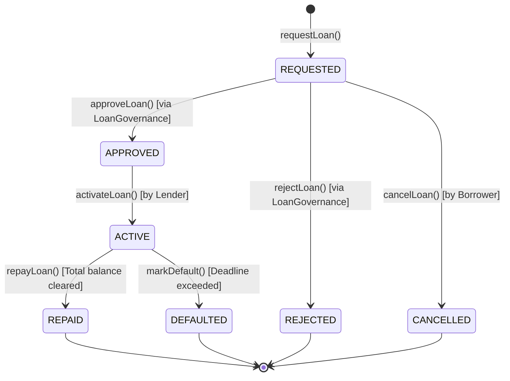

# CredChain — Smart Contracts Technical Specification

## Module 1 — Loan Lifecycle Management (`LoanManager.sol`)

### State Machine Specification

`LoanManager.sol` implements a formal state machine for micro-lending contracts:

### Transition Rules and Known Gaps

| From | To | Caller | Guard |
|------|----|--------|-------|
| REQUESTED | APPROVED | Governance or OPERATOR | status == REQUESTED |
| REQUESTED | REJECTED | Governance or OPERATOR | status == REQUESTED |
| REQUESTED | CANCELLED | Borrower | status == REQUESTED |
| APPROVED | ACTIVE | Any lender | `block.timestamp <= approvalTime + 7 days` |
| ACTIVE | REPAID | Borrower | cumulative repayment >= principal + interest |
| ACTIVE | DEFAULTED | Anyone | `block.timestamp > repaymentDeadline` |

**Known gap:** No function moves an APPROVED loan whose approval has expired. `activateLoan` reverts with `ApprovalExpired`, and the loan stays in APPROVED. It also counts toward the borrower's `MAX_ACTIVE_LOANS_PER_BORROWER` cap, so five expired approvals block new requests. `cancelLoan` only works from REQUESTED. Tests characterizing this are in `test/LoanManagerInvariant.t.sol` (`test_KnownGap_*`).

**Interest:** `_calculateTotalOwed` applies a flat rate, `principal * (10000 + bps) / 10000`, and ignores `duration`. Owed is the same for a 1-day loan and a 365-day loan at the same rate. Time-based simple interest is not implemented.

Invariants checked by `LoanManagerInvariantTest` (stateful, handler-driven): legal transitions only, active-loan counter matches statuses, repaid never exceeds owed, REPAID implies fully repaid.

---

### Emitted Events
- `LoanRequested(uint256 indexed loanId, address indexed borrower, uint256 amount, uint256 collateral)`
- `LoanApproved(uint256 indexed loanId, address indexed approver)`
- `LoanRejected(uint256 indexed loanId, address indexed rejector)`
- `LoanActivated(uint256 indexed loanId, address indexed lender, uint256 timestamp)`
- `LoanRepaid(uint256 indexed loanId, uint256 amount, uint256 remaining)`
- `LoanDefaulted(uint256 indexed loanId, uint256 timestamp)`
- `LoanClosed(uint256 indexed loanId)`
- `LoanCancelled(uint256 indexed loanId, address indexed borrower)`

---

## Module 2 — ERC-20 Tokenization and Escrow (`CredToken.sol`, `LoanEscrow.sol`)

### CredToken.sol
- Implements OpenZeppelin `ERC20`, `AccessControl`, and `Pausable`.
- Maximum supply: 100,000,000 CRED tokens.
- Per-transaction mint ceiling: 10,000 CRED.
- Public faucet for testnet users: max 1,000 CRED per call.

### LoanEscrow.sol
- Non-custodial vault holding borrower collateral and lender funding.
- Strict checks-effects-interactions order preventing reentrancy attacks.
- Separate accounting per loan ID:
  - Collateral balance
  - Loan fund balance
  - Repayment balance
  - Release & disbursement boolean flags preventing double-withdrawals.

---

## Module 3 — Decentralized Authorization (`LoanGovernance.sol`)

### Multi-Signature Threshold Logic
- **Standard Loans** (< 5,000 CRED): Requires `approvalThreshold` (1 approver).
- **High-Value Loans** (>= 5,000 CRED): Requires `highValueApprovalThreshold` (2 independent approvers).
- Roles defined via OpenZeppelin `AccessControl`:
  - `DEFAULT_ADMIN_ROLE`: Configures thresholds and grants roles.
  - `APPROVER_ROLE`: Evaluates off-chain risk hashes and signs approvals.
  - `PAUSER_ROLE`: Emergency circuit breaker stop.

---

## Module 4 — Chainlink Oracle & Borrower Reputation (`CollateralOracle.sol`, `BorrowerReputation.sol`)

### CollateralOracle.sol
- Interfaces with Chainlink Sepolia ETH/USD aggregator `0x694AA1769357215DE4FAC081bf1f309aDC325306`.
- Heartbeat & Staleness check: Reverts if `block.timestamp - updatedAt > stalenessPeriod` (3600s default).
- Non-positive price guard: Reverts on zero or negative values.
- Computes LTV ratio in basis points: `(loanAmountUSD * 10000) / collateralUSD`.

### BorrowerReputation.sol
- Transparent deterministic reputation formula:
  $$\text{Reputation Score} = \frac{\text{Repaid Loans} \times 100}{\text{Total Loans}}$$
- Uninitialized borrowers receive neutral baseline score of 50.
- Strict permissions: Only contracts holding `RECORDER_ROLE` (`LoanManager.sol`) can update borrower metrics. Arbitrary user self-incrementation is impossible.
